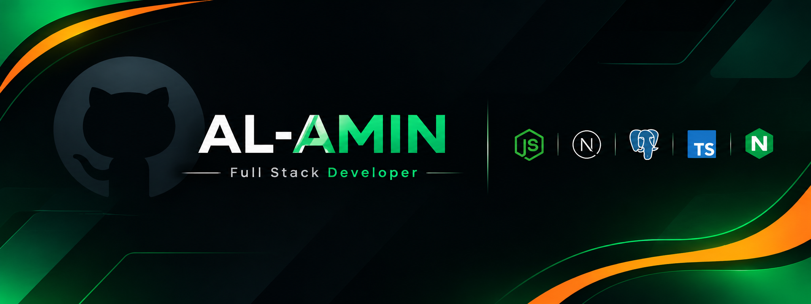

# AL-AMIN | Full Stack Developer

  

  

---

## 👋 About Me

I'm **AL-AMIN**, a passionate **Full-Stack Web Developer** dedicated to building modern, scalable, and high-performance web applications.

I work with **JavaScript, TypeScript, React, Next.js, Node.js, Express.js, MongoDB, and PostgreSQL** to develop end-to-end digital solutions.

I enjoy transforming complex ideas into practical applications through clean code, thoughtful architecture, reusable components, and intuitive user experiences.

I'm continuously exploring emerging technologies, strengthening my software engineering skills, and embracing new challenges to grow as a developer.

## 🛠️ Skills & Technologies

**Frontend Development**

  

**Backend Development**

  

**Database & Storage**

  

**Tools & Platforms**

  
  

**AI & Development Workflow**

  
  

## 🤝 Connect With Me

  
  
  

## 📊 GitHub Statistics

  
  

## 📈 Contribution Activity

  

---

  Building, learning, and growing — one commit at a time.

